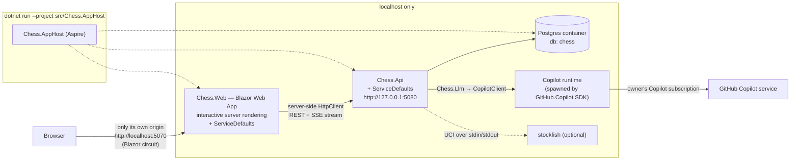

# 03 — Target architecture

**LLM Chess Arena** — a local tool that makes LLMs available on the owner's GitHub Copilot
subscription play chess against each other and ranks them with a published, deterministic
formula ([`docs/RATING.md`](../RATING.md)).

## 1. Shape



The only traffic that leaves the machine is the Copilot runtime talking to GitHub Copilot,
which is the product's purpose (R2). Nothing is deployed (R1).

## 2. Solution layout

```
global.json  Directory.Build.props  Directory.Packages.props  .editorconfig  Chess.sln
src/
  Chess.AppHost/          Aspire composition root: Postgres, Chess.Api, Chess.Web
  Chess.ServiceDefaults/  kernel: OTel, health (/health, /alive), problem details — no domain
  Chess.Engine/           pure chess rules: FEN, SAN, legal moves, status, PGN   (moved from ChessApi/Chess)
  Chess.Llm/              ILlmGateway + CopilotLlmGateway + FakeLlmGateway — the only project that references GitHub.Copilot.SDK
  Chess.Analysis/         IMoveQualityAnalyzer + StockfishAnalyzer + NoOpAnalyzer
  Chess.Rating/           pure rating maths (RATING.md) — no I/O, no clock, no EF
  Chess.Api/              the one service: players, game runner, tournaments, persistence, endpoints
  Chess.Web/              Blazor Web App (interactive server): the UI, ported from ChessBlazor
tests/
  Chess.Engine.Tests/  Chess.Rating.Tests/  Chess.Llm.Tests/  Chess.Api.Tests/  Chess.Web.Tests/
  Chess.E2E/              Playwright for .NET, against the AppHost with the fake gateway
docs/  architecture/ RATING.md  …
```

Target framework **`net10.0`** for every project (current LTS). Package versions only in
`Directory.Packages.props`.

### Project references (allowed edges — anything else is a review finding)

```
Chess.Api       → Chess.ServiceDefaults, Chess.Engine, Chess.Llm, Chess.Analysis, Chess.Rating
Chess.Analysis  → Chess.Engine
Chess.Llm       → (none)
Chess.Rating    → (none)
Chess.Engine    → (none)
Chess.Web       → Chess.ServiceDefaults           (talks to Chess.Api over HTTP only — its DTOs are its own copies)
Chess.AppHost   → Chess.Api, Chess.Web (as project resources)
```

### Dependency budget

| Project | Allowed packages |
|---|---|
| Chess.Engine, Chess.Rating | none |
| Chess.Llm | `GitHub.Copilot.SDK` (1.0.x) |
| Chess.Analysis | none (Stockfish is an external binary, not a package) |
| Chess.Api | EF Core + `Npgsql.EntityFrameworkCore.PostgreSQL`, `Microsoft.EntityFrameworkCore.InMemory` |
| Chess.ServiceDefaults | OpenTelemetry.*, `Microsoft.Extensions.ServiceDiscovery`, `Microsoft.Extensions.Http.Resilience` |
| Chess.Web | none beyond the ASP.NET Core shared framework. **No JS dependencies, no component library, no chess library** — the board is a Razor SVG component rendered from FEN |
| Chess.AppHost | `Aspire.Hosting.AppHost`, `Aspire.Hosting.PostgreSQL` |
| tests | xUnit, `Microsoft.AspNetCore.Mvc.Testing`, `bunit` (Chess.Web.Tests), `Microsoft.Playwright` (Chess.E2E) |

## 3. Contracts (fixed in wave 0 — implementations in later waves code against these)

These signatures are created verbatim by `T0.2`. Changing one after wave 0 is a supervisor
decision, not a task-level one, because several parallel tasks depend on it.

### 3.1 `Chess.Llm`

```csharp
namespace Chess.Llm;

public interface ILlmGateway
{
    LlmGatewayStatus Status { get; }
    Task<IReadOnlyList<LlmModelInfo>> ListModelsAsync(CancellationToken ct);
    Task<ILlmConversation> StartConversationAsync(LlmConversationOptions options, CancellationToken ct);
}

public interface ILlmConversation : IAsyncDisposable
{
    string ModelId { get; }
    Task<LlmReply> AskAsync(string prompt, CancellationToken ct);
}

public enum LlmGatewayState { Ready, NotAuthenticated, Unavailable, Fake }
public sealed record LlmGatewayStatus(LlmGatewayState State, string Detail);
public sealed record LlmModelInfo(string Id, string DisplayName, double? PremiumMultiplier, bool Enabled);
public sealed record LlmConversationOptions(string ModelId, string SystemPrompt, TimeSpan Timeout);
public sealed record LlmReply(string Text, TimeSpan Latency, int? InputTokens, int? OutputTokens);

public sealed class LlmUnavailableException(string message) : Exception(message);
```

`CopilotLlmGateway` rules:
- One `CopilotClient` per process, started by a hosted service, stopped on shutdown.
  Authentication is the logged-in user (`UseLoggedInUser`, the SDK default); an optional
  `Copilot:GitHubToken` parameter overrides it. No token is ever logged or stored.
- One SDK session per `ILlmConversation`, i.e. **one per side per game**. The system prompt is
  the session's system message; every move is one `SendAsync` + wait for `SessionIdleEvent`,
  with the timeout from the options.
- **No tools**: the session is created with an empty available-tools list and an
  `OnPermissionRequest` handler that rejects everything. A chess move never needs a tool, and
  an agent loop would make latency and premium-request cost unbounded.
- Copilot SDK types (`CopilotClient`, `SessionConfig`, events) never appear in a public
  signature of `Chess.Llm` (P11).
- `Status`: `Ready` after a successful start and model listing; `NotAuthenticated` when the
  runtime reports no user; `Unavailable` when the runtime cannot be started. Startup never fails
  because of Copilot (P8).

`FakeLlmGateway` (selected by `Llm:Provider=Fake`): deterministic; answers with a legal move
chosen by a seeded RNG from the `Legal moves:` line of the prompt, and can be scripted with
illegal replies for tests. It is how CI and E2E run without a subscription.

### 3.2 Players (`Chess.Api/Players`)

```csharp
namespace Chess.Api.Players;

public sealed record PlayerDescriptor(string Kind, string ModelId);        // Kind: "llm" | "random"
public sealed record MoveRequest(Guid GameId, int Ply, string Fen,
    IReadOnlyList<string> LegalSan, IReadOnlyList<string> HistorySan);
public sealed record MoveAttempt(int Number, string Prompt, string? RawReply, string? ParsedSan,
    bool Legal, TimeSpan Latency, int? InputTokens, int? OutputTokens, string? Error);
public sealed record PlayerMove(string? San, IReadOnlyList<MoveAttempt> Attempts, bool Forfeit);

public interface IChessPlayer : IAsyncDisposable
{
    PlayerDescriptor Descriptor { get; }
    Task<PlayerMove> ChooseMoveAsync(MoveRequest request, CancellationToken ct);
}

public interface IChessPlayerFactory
{
    Task<IChessPlayer> CreateAsync(PlayerDescriptor descriptor, Guid gameId, Chess.Engine.Side side, CancellationToken ct);
}
```

### 3.3 Games (`Chess.Api/Games`)

```csharp
namespace Chess.Api.Games;

public interface IGameRunner
{
    ValueTask EnqueueAsync(Guid gameId, CancellationToken ct);
    bool TryAbort(Guid gameId);
}

public interface IGameEvent { Guid GameId { get; } DateTimeOffset At { get; } }
public sealed record MoveStarted(Guid GameId, DateTimeOffset At, int Ply, string Color, string ModelId) : IGameEvent;
public sealed record AttemptRejected(Guid GameId, DateTimeOffset At, int Ply, int Attempt, string? RawReply, string Reason) : IGameEvent;
public sealed record MovePlayed(Guid GameId, DateTimeOffset At, int Ply, string Color, string San, string Fen, int Attempts, long LatencyMs) : IGameEvent;
public sealed record GameFinished(Guid GameId, DateTimeOffset At, string Result, string Termination) : IGameEvent;

public interface IGameEventStream
{
    void Publish(IGameEvent e);
    IAsyncEnumerable<IGameEvent> SubscribeAsync(Guid gameId, CancellationToken ct);
}
```

`Result` is PGN-style: `"1-0" | "0-1" | "1/2-1/2" | "*"`. `Termination` is one of
`checkmate, stalemate, insufficient-material, fifty-move, threefold, forfeit-white,
forfeit-black, adjudicated, aborted, interrupted`.

### 3.4 Rating (`Chess.Rating`) — see RATING.md for the maths

```csharp
namespace Chess.Rating;

public sealed record GameOutcome(string White, string Black, double WhiteScore);   // 1, 0.5, 0
public sealed record PlayerMoveStats(string Model, int Moves, int FirstAttemptLegal, double? AverageCentipawnLoss);
public sealed record RatingOptions(
    string? AnchorModel = "random", double AnchorRating = 0, double? PriorSigma = 350,
    int BootstrapSamples = 200, int Seed = 20261024, int ProvisionalBelowGames = 20,
    double ResultWeight = 0.75, double MoveQualityWeight = 0.6);
public sealed record ModelRating(string Model, double Rating, double CiLow, double CiHigh,
    int Games, double Score, double Legality, double? MoveQuality, double Quality,
    double ArenaScore, bool Provisional);
public sealed record PairwiseCoefficient(string A, string B, double ExpectedScore, double QualityShare,
    double Rqc, double RqcLow, double RqcHigh, double EloEquivalent,
    int HeadToHeadGames, double? HeadToHeadScore);
public sealed record RatingReport(IReadOnlyList<ModelRating> Models, double WhiteAdvantage, int Games);

// T0.2 creates this class with both methods throwing NotImplementedException; T1.6 implements them.
public static class RatingCalculator
{
    public static RatingReport Compute(IReadOnlyList<GameOutcome> games,
        IReadOnlyList<PlayerMoveStats> stats, RatingOptions options);
    public static PairwiseCoefficient Pairwise(RatingReport report, IReadOnlyList<GameOutcome> games, string a, string b);
}
```

### 3.5 Analysis (`Chess.Analysis`)

```csharp
namespace Chess.Analysis;

public sealed record MoveQuality(int Ply, int CentipawnLoss, string BestSan);
public interface IMoveQualityAnalyzer
{
    bool IsAvailable { get; }
    Task<IReadOnlyList<MoveQuality>> AnalyzeAsync(string startFen, IReadOnlyList<string> sanMoves, CancellationToken ct);
    /// <summary>Centipawns from White's point of view (mate = ±1000); null when unavailable.</summary>
    Task<int?> EvaluateAsync(string fen, CancellationToken ct);
}
```

## 4. Data model (Postgres, EF Core migrations)

| Table | Key columns |
|---|---|
| `games` | `id`, `tournament_id?`, `white_kind`, `white_model`, `black_kind`, `black_model`, `rated` (bool), `result`, `termination`, `start_fen`, `current_fen`, `ply_count`, `pgn`, `created_at`, `started_at?`, `finished_at?` |
| `moves` | `game_id`, `ply` (unique together), `color`, `san`, `fen_after`, `attempts`, `latency_ms`, `input_tokens?`, `output_tokens?`, `centipawn_loss?`, `best_san?`, `played_at` |
| `move_attempts` | `game_id`, `ply`, `number`, `prompt`, `raw_reply?`, `parsed_san?`, `legal`, `latency_ms`, `error?`, `created_at` (replaces `PromptLogs`) |
| `tournaments` | `id`, `name`, `models` (jsonb string[]), `games_per_pair`, `max_concurrency`, `status`, `created_at`, `finished_at?` |
| `rating_snapshots` | `id`, `taken_at`, `after_game_id`, `rated_games`, `model`, `rating`, `ci_low`, `ci_high`, `arena_score`, `games`, `provisional`, `formula_version` — one row per model, appended after every finished rated game |

**Everything is persisted in Postgres** (owner requirement, 2026-10-24): games, every move,
every LLM attempt with its prompt and reply, tournaments, and the rating history. The default
run (`dotnet run --project src/Chess.AppHost`) always uses the Aspire-managed Postgres container
with the named volume `chess-arena-pg`, so data survives restarts of the app and of the
container. `InMemory` exists only for tests and the `fake` launch profile. An existing Postgres
can be used instead by setting the AppHost connection string `chess` (`ConnectionStrings:chess`
in AppHost user secrets) — then no container is started.

The **current** leaderboard is still recomputed from the games table on read (pure function),
so every number on screen is reproducible from stored games. `rating_snapshots` is the
persisted history of those computations, for the rating-over-time chart; it is written, never
read back into a calculation.

## 5. API (minimal API, `/api` prefix, JSON, RFC 7807 errors)

| Method & path | Purpose | Task |
|---|---|---|
| `GET /api/models` | Copilot models (+ `random`), with premium multiplier when known | T2.6 |
| `GET /api/status` | gateway / database / analyzer state (also in `/health` details) | T2.6 |
| `POST /api/games` | `{ white:{kind,modelId}, black:{kind,modelId}, rated }` → 201, runner starts it | T2.3 |
| `GET /api/games?page&pageSize&model&status` | archive, from the database | T2.3 |
| `GET /api/games/{id}` | full state incl. moves | T2.3 |
| `GET /api/games/{id}/events` | `text/event-stream` of `IGameEvent` (JSON, `event:` = type name) | T2.3 |
| `GET /api/games/{id}/pgn` | PGN download | T2.3 |
| `DELETE /api/games/{id}` | abort | T2.3 |
| `POST /api/tournaments` / `GET /api/tournaments[/{id}]` / `DELETE …/{id}` | round robin | T2.4 |
| `GET /api/ratings` | leaderboard (`ModelRating[]`, white advantage, n games) | T2.5 |
| `GET /api/ratings/pairwise?a=&b=` | `PairwiseCoefficient` | T2.5 |
| `GET /api/ratings/matrix` | RQC for every ordered pair | T2.5 |
| `GET /api/ratings/history?model` | `RatingHistoryPointDto[]` from `rating_snapshots`, oldest first | T2.9 |
| `GET /api/results/breakdown?tournamentId` | `ModelResultsDto[]`: W/D/L, forfeits, latency, tokens per model | T2.9 |
| `GET /api/attempts?gameId&model&page` | prompt/attempt log (admin view) | T2.7 |

### 5.1 API DTOs (`Chess.Api/Contracts/ApiContracts.cs`, frozen in wave 0)

`Chess.Web` keeps its own copies of these records in `Chess.Web/Api/ApiContracts.cs`. JSON is
camelCase; enums are strings.

```csharp
namespace Chess.Api.Contracts;

public sealed record PlayerSpec(string Kind, string ModelId);                       // Kind: "llm" | "random"
public sealed record CreateGameRequest(PlayerSpec White, PlayerSpec Black, bool Rated);
public sealed record GameSummaryDto(Guid Id, Guid? TournamentId, PlayerSpec White, PlayerSpec Black, bool Rated,
    string State, string Result, string? Termination, int PlyCount,
    DateTimeOffset CreatedAt, DateTimeOffset? FinishedAt);                          // State: queued | running | finished
public sealed record MoveDto(int Ply, string Color, string San, string FenAfter, int Attempts, long LatencyMs,
    int? InputTokens, int? OutputTokens, int? CentipawnLoss, string? BestSan);
public sealed record GameDetailDto(GameSummaryDto Summary, string StartFen, string CurrentFen, IReadOnlyList<MoveDto> Moves);
public sealed record PageDto<T>(IReadOnlyList<T> Items, int Page, int PageSize, int Total);
public sealed record CreateTournamentRequest(string Name, IReadOnlyList<string> Models, int GamesPerPair, int MaxConcurrency);
public sealed record TournamentDto(Guid Id, string Name, IReadOnlyList<string> Models, int GamesPerPair, string Status,
    int GamesTotal, int GamesFinished, DateTimeOffset CreatedAt, DateTimeOffset? FinishedAt);  // Status: running | finished | cancelled
// Response of POST /api/tournaments (supervisor decision 2026-10-24, introduced by T2.4): the created
// tournament plus the premium-request estimate per model (null when the multiplier is unknown).
public sealed record TournamentCreatedDto(TournamentDto Tournament, IReadOnlyList<ModelPremiumEstimateDto> EstimatedPremiumRequests);
public sealed record ModelPremiumEstimateDto(string ModelId, double? EstimatedPremiumRequests);
public sealed record ModelDto(string Id, string DisplayName, double? PremiumMultiplier, bool Enabled);
public sealed record StatusDto(string Copilot, string CopilotDetail, string Database, string Stockfish);
public sealed record LeaderboardDto(IReadOnlyList<Chess.Rating.ModelRating> Models, double WhiteAdvantage, int Games, bool MoveQualityAvailable);
public sealed record MatrixDto(IReadOnlyList<string> Models, IReadOnlyList<Chess.Rating.PairwiseCoefficient> Cells);
public sealed record RatingHistoryPointDto(DateTimeOffset TakenAt, int RatedGames, string Model, double Rating,
    double CiLow, double CiHigh, double ArenaScore, bool Provisional);
public sealed record ModelResultsDto(string Model, int Games, int Wins, int Draws, int Losses, int ForfeitLosses,
    int Moves, double FirstAttemptLegalRate, double AvgLatencyMs, double? AvgInputTokens, double? AvgOutputTokens,
    double? AverageCentipawnLoss);
public sealed record AttemptDto(Guid GameId, int Ply, int Number, string ModelId, string Prompt, string? RawReply,
    string? ParsedSan, bool Legal, long LatencyMs, string? Error, DateTimeOffset CreatedAt);
```

SSE (`/api/games/{id}/events`): one message per `IGameEvent`; `event:` is the record type name
(`MoveStarted`, `AttemptRejected`, `MovePlayed`, `GameFinished`), `data:` its camelCase JSON. The
stream replays nothing, so a client **opens the stream first, then loads** `GET /api/games/{id}`
and ignores events whose `ply` is not greater than the loaded `PlyCount`. The stream closes after
`GameFinished` (immediately, with that one event, if the game is already finished). A heartbeat comment line (`: ping`) every 15 s.

## 6. Frontend (`Chess.Web`, Blazor)

Blazor Web App with **interactive server** render mode (owner decision, ADR-005), ported from
`ChessBlazor` (WASM). The browser holds a Blazor circuit to `Chess.Web` and nothing else, which
gives the property the standard's BFF exists for — the browser never learns the API's address
and there is no CORS — without a second stack:

- `ArenaApiClient` (typed `HttpClient`, base address `http://api` resolved by Aspire service
  discovery, standard resilience handler from ServiceDefaults) with its own DTO records
  mirroring §5. The DTOs are copies, not a project reference to `Chess.Api` (P3: contract over
  HTTP).
- Live updates: `GameEventsClient` reads `GET /api/games/{id}/events` as a stream
  (`HttpCompletionOption.ResponseHeadersRead`, line-by-line SSE parsing) and raises C# events
  the page re-renders on. No SignalR client package, no hub on the API.
- Pages: `/results` (**first item in the navigation**) · `/` live game · `/head-to-head` ·
  `/tournaments` (+ `/{id}`) · `/games` (+ `/{id}` replay) · `/admin/attempts`.
- Charts are pure Razor SVG components in `Components/Charts/` (no JS library), following the
  dataviz rules in §6.1.

### 6.1 The Results page (`/results`) — "who is best" before any scrolling

Order on the page is fixed; everything renders top to bottom in one column:

1. **Big Picture** (above the fold, full width). A headline sentence —
   *"Best overall: **{model}** — arena score {AS}, rating {R} ± {CI}"* plus *"significantly
   ahead of #2 ({model2}, RQC {x})"* or *"not yet significantly ahead of #2"* when the RQC
   interval vs #2 contains 0.5 — followed by a **horizontal ranked bar chart** of arena score for
   every model, sorted best-first, with the 95 % interval as a whisker, the leader's bar in the
   accent colour and all others in one neutral series colour, provisional models hatched and
   labelled, the value direct-labelled at the end of each bar. Filter row above it: all games /
   one tournament.
2. **Rating over time** — line chart from `/api/ratings/history`, x = rated games played, one
   line per model (≤ 8, the rest folded into a "+N more" toggle), legend + direct label at the
   line end.
3. **Head-to-head matrix** — RQC heatmap, row model vs column model, diverging colour scale
   with a neutral grey at 0.5, cell text value, non-significant cells muted.
4. **Results breakdown** — horizontal 100 % stacked bar per model: wins / draws / losses /
   forfeit losses.
5. **Move quality** — two separate bar charts (never a dual axis): first-attempt legality %
   and ACPL (the second only when Stockfish data exists).
6. **Strength vs cost** — scatter of rating (y) against average latency per move (x), one
   neutral colour, every point direct-labelled with the model name.
7. **Full table** — the leaderboard as a table (accessible view of the same data).

Chart rules (from the dataviz guidance): one axis per chart; colour follows the model, never
its rank (slot assigned by the model id's position in the alphabetically sorted list of all
models ever rated, so filtering does not repaint); categorical palette in fixed order
`#2a78d6 #eb6834 #1baf7a #eda100 #e87ba4 #008300 #6250d6 #e34948` (dark mode:
`#3987e5 #d95926 #199e70 #c98500 #d55181 #008300 #9085e9 #e66767`); text in text colours,
never the series colour; 2 px lines, bars with 4 px rounded data-end; recessive grid; every
mark has an SVG `<title>` tooltip (hover) and the page has a table view; light and dark themes.
- Components kept from ChessBlazor where they still fit (`MoveHistory`, `StatusBadge`,
  `AnalysisPanel`); `ChessBoard` becomes a pure SVG component from FEN instead of fetching
  `/board-svg`. Template leftovers (`Counter`, `Weather`, `Home`, `sample-data`) are deleted.
- No login: single-user localhost tool (ADR-006).

## 7. Runtime behaviour that the ranking depends on

- The game runs **server-side** in a `BackgroundService` reading a bounded `Channel<Guid>`;
  concurrency is capped by `Arena:MaxConcurrentGames` (default 2) because every move is a
  Copilot request. Browsers only observe.
- On start-up, games left `started` but unfinished are marked `termination=interrupted`,
  `result="*"`, and are excluded from rating.
- Illegal reply → the attempt is recorded, the player gets one corrective follow-up in the
  same conversation; after `Arena:MaxAttemptsPerMove` (default 3) the side **forfeits**.
  There is no fallback move.
- Plies capped at `Arena:MaxPlies` (default 200) → adjudication (RATING.md §2).
- Rated games use one fixed prompt template, no personality, the same timeout for both sides.

## 8. Health and degradation (P8)

`/health` (readiness) returns `database`, `copilot` (`Ready | NotAuthenticated |
Unavailable | Fake`), `stockfish` (`available | absent`). The startup log prints the same
three lines. With Copilot unavailable the app still runs: `random` players and the archive
work, LLM games are refused with a 503 problem that says how to log in.
