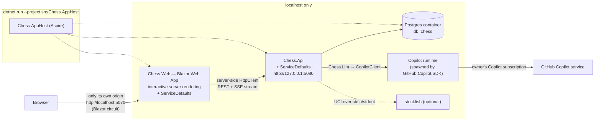

# 03 — Target architecture

**LLM Chess Arena** — a local tool that makes LLMs available on the owner's GitHub Copilot
subscription play chess against each other and ranks them with a published, deterministic
formula ([`docs/RATING.md`](../RATING.md)).

## 1. Shape



The only traffic that leaves the machine is the Copilot runtime talking to GitHub Copilot,
which is the product's purpose (R2). Nothing is deployed (R1).

## 2. Solution layout

```
global.json  Directory.Build.props  Directory.Packages.props  .editorconfig  Chess.sln
src/
  Chess.AppHost/          Aspire composition root: Postgres, Chess.Api, Chess.Web
  Chess.ServiceDefaults/  kernel: OTel, health (/health, /alive), problem details — no domain
  Chess.Engine/           pure chess rules: FEN, SAN, legal moves, status, PGN   (moved from ChessApi/Chess)
  Chess.Llm/              ILlmGateway + CopilotLlmGateway + FakeLlmGateway — the only project that references GitHub.Copilot.SDK
  Chess.Analysis/         IMoveQualityAnalyzer + StockfishAnalyzer + NoOpAnalyzer
  Chess.Rating/           pure rating maths (RATING.md) — no I/O, no clock, no EF
  Chess.Api/              the one service: players, game runner, tournaments, persistence, endpoints
  Chess.Web/              Blazor Web App (interactive server): the UI, ported from ChessBlazor
tests/
  Chess.Engine.Tests/  Chess.Rating.Tests/  Chess.Llm.Tests/  Chess.Api.Tests/  Chess.Web.Tests/
  Chess.E2E/              Playwright for .NET, against the AppHost with the fake gateway
docs/  architecture/ RATING.md  …
```

Target framework **`net10.0`** for every project (current LTS). Package versions only in
`Directory.Packages.props`.

### Project references (allowed edges — anything else is a review finding)

```
Chess.Api       → Chess.ServiceDefaults, Chess.Engine, Chess.Llm, Chess.Analysis, Chess.Rating
Chess.Analysis  → Chess.Engine
Chess.Llm       → (none)
Chess.Rating    → (none)
Chess.Engine    → (none)
Chess.Web       → Chess.ServiceDefaults           (talks to Chess.Api over HTTP only — its DTOs are its own copies)
Chess.AppHost   → Chess.Api, Chess.Web (as project resources)
```

### Dependency budget

| Project | Allowed packages |
|---|---|
| Chess.Engine, Chess.Rating | none |
| Chess.Llm | `GitHub.Copilot.SDK` (1.0.x) |
| Chess.Analysis | none (Stockfish is an external binary, not a package) |
| Chess.Api | EF Core + `Npgsql.EntityFrameworkCore.PostgreSQL`, `Microsoft.EntityFrameworkCore.InMemory` |
| Chess.ServiceDefaults | OpenTelemetry.*, `Microsoft.Extensions.ServiceDiscovery`, `Microsoft.Extensions.Http.Resilience` |
| Chess.Web | none beyond the ASP.NET Core shared framework. **No JS dependencies, no component library, no chess library** — the board is a Razor SVG component rendered from FEN |
| Chess.AppHost | `Aspire.Hosting.AppHost`, `Aspire.Hosting.PostgreSQL` |
| tests | xUnit, `Microsoft.AspNetCore.Mvc.Testing`, `bunit` (Chess.Web.Tests), `Microsoft.Playwright` (Chess.E2E) |

## 3. Contracts (fixed in wave 0 — implementations in later waves code against these)

These signatures are created verbatim by `T0.2`. Changing one after wave 0 is a supervisor
decision, not a task-level one, because several parallel tasks depend on it.

### 3.1 `Chess.Llm`

```csharp
namespace Chess.Llm;

public interface ILlmGateway
{
    LlmGatewayStatus Status { get; }
    Task<IReadOnlyList<LlmModelInfo>> ListModelsAsync(CancellationToken ct);
    Task<ILlmConversation> StartConversationAsync(LlmConversationOptions options, CancellationToken ct);
}

public interface ILlmConversation : IAsyncDisposable
{
    string ModelId { get; }
    Task<LlmReply> AskAsync(string prompt, CancellationToken ct);
}

public enum LlmGatewayState { Ready, NotAuthenticated, Unavailable, Fake }
public sealed record LlmGatewayStatus(LlmGatewayState State, string Detail);
public sealed record LlmModelInfo(string Id, string DisplayName, double? PremiumMultiplier, bool Enabled);
public sealed record LlmConversationOptions(string ModelId, string SystemPrompt, TimeSpan Timeout);
public sealed record LlmReply(string Text, TimeSpan Latency, int? InputTokens, int? OutputTokens);

public sealed class LlmUnavailableException(string message) : Exception(message);
```

`CopilotLlmGateway` rules:
- One `CopilotClient` per process, started by a hosted service, stopped on shutdown.
  Authentication is the logged-in user (`UseLoggedInUser`, the SDK default); an optional
  `Copilot:GitHubToken` parameter overrides it. No token is ever logged or stored.
- One SDK session per `ILlmConversation`, i.e. **one per side per game**. The system prompt is
  the session's system message; every move is one `SendAsync` + wait for `SessionIdleEvent`,
  with the timeout from the options.
- **No tools**: the session is created with an empty available-tools list and an
  `OnPermissionRequest` handler that rejects everything. A chess move never needs a tool, and
  an agent loop would make latency and premium-request cost unbounded.
- Copilot SDK types (`CopilotClient`, `SessionConfig`, events) never appear in a public
  signature of `Chess.Llm` (P11).
- `Status`: `Ready` after a successful start and model listing; `NotAuthenticated` when the
  runtime reports no user; `Unavailable` when the runtime cannot be started. Startup never fails
  because of Copilot (P8).

`FakeLlmGateway` (selected by `Llm:Provider=Fake`): deterministic; answers with a legal move
chosen by a seeded RNG from the `Legal moves:` line of the prompt, and can be scripted with
illegal replies for tests. It is how CI and E2E run without a subscription.

### 3.2 Players (`Chess.Api/Players`)

```csharp
namespace Chess.Api.Players;

public sealed record PlayerDescriptor(string Kind, string ModelId);        // Kind: "llm" | "random"
public sealed record MoveRequest(Guid GameId, int Ply, string Fen,
    IReadOnlyList<string> LegalSan, IReadOnlyList<string> HistorySan);
public sealed record MoveAttempt(int Number, string Prompt, string? RawReply, string? ParsedSan,
    bool Legal, TimeSpan Latency, int? InputTokens, int? OutputTokens, string? Error);
public sealed record PlayerMove(string? San, IReadOnlyList<MoveAttempt> Attempts, bool Forfeit);

public interface IChessPlayer : IAsyncDisposable
{
    PlayerDescriptor Descriptor { get; }
    Task<PlayerMove> ChooseMoveAsync(MoveRequest request, CancellationToken ct);
}

public interface IChessPlayerFactory
{
    Task<IChessPlayer> CreateAsync(PlayerDescriptor descriptor, Guid gameId, Chess.Engine.Side side, CancellationToken ct);
}
```

### 3.3 Games (`Chess.Api/Games`)

```csharp
namespace Chess.Api.Games;

public interface IGameRunner
{
    ValueTask EnqueueAsync(Guid gameId, CancellationToken ct);
    bool TryAbort(Guid gameId);
}

public interface IGameEvent { Guid GameId { get; } DateTimeOffset At { get; } }
public sealed record MoveStarted(Guid GameId, DateTimeOffset At, int Ply, string Color, string ModelId) : IGameEvent;
public sealed record AttemptRejected(Guid GameId, DateTimeOffset At, int Ply, int Attempt, string? RawReply, string Reason) : IGameEvent;
public sealed record MovePlayed(Guid GameId, DateTimeOffset At, int Ply, string Color, string San, string Fen, int Attempts, long LatencyMs) : IGameEvent;
public sealed record GameFinished(Guid GameId, DateTimeOffset At, string Result, string Termination) : IGameEvent;

public interface IGameEventStream
{
    void Publish(IGameEvent e);
    IAsyncEnumerable<IGameEvent> SubscribeAsync(Guid gameId, CancellationToken ct);
}
```

`Result` is PGN-style: `"1-0" | "0-1" | "1/2-1/2" | "*"`. `Termination` is one of
`checkmate, stalemate, insufficient-material, fifty-move, threefold, forfeit-white,
forfeit-black, adjudicated, aborted, interrupted`.

### 3.4 Rating (`Chess.Rating`) — see RATING.md for the maths

```csharp
namespace Chess.Rating;

public sealed record GameOutcome(string White, string Black, double WhiteScore);   // 1, 0.5, 0
public sealed record PlayerMoveStats(string Model, int Moves, int FirstAttemptLegal, double? AverageCentipawnLoss);
public sealed record RatingOptions(
    string? AnchorModel = "random", double AnchorRating = 0, double? PriorSigma = 350,
    int BootstrapSamples = 200, int Seed = 20261024, int ProvisionalBelowGames = 20,
    double ResultWeight = 0.75, double MoveQualityWeight = 0.6);
public sealed record ModelRating(string Model, double Rating, double CiLow, double CiHigh,
    int Games, double Score, double Legality, double? MoveQuality, double Quality,
    double ArenaScore, bool Provisional);
public sealed record PairwiseCoefficient(string A, string B, double ExpectedScore, double QualityShare,
    double Rqc, double RqcLow, double RqcHigh, double EloEquivalent,
    int HeadToHeadGames, double? HeadToHeadScore);
public sealed record RatingReport(IReadOnlyList<ModelRating> Models, double WhiteAdvantage, int Games);

// T0.2 creates this class with both methods throwing NotImplementedException; T1.6 implements them.
public static class RatingCalculator
{
    public static RatingReport Compute(IReadOnlyList<GameOutcome> games,
        IReadOnlyList<PlayerMoveStats> stats, RatingOptions options);
    public static PairwiseCoefficient Pairwise(RatingReport report, IReadOnlyList<GameOutcome> games, string a, string b);
}
```

### 3.5 Analysis (`Chess.Analysis`)

```csharp
namespace Chess.Analysis;

public sealed record MoveQuality(int Ply, int CentipawnLoss, string BestSan);
public interface IMoveQualityAnalyzer
{
    bool IsAvailable { get; }
    Task<IReadOnlyList<MoveQuality>> AnalyzeAsync(string startFen, IReadOnlyList<string> sanMoves, CancellationToken ct);
    /// <summary>Centipawns from White's point of view (mate = ±1000); null when unavailable.</summary>
    Task<int?> EvaluateAsync(string fen, CancellationToken ct);
}
```

## 4. Data model (Postgres, EF Core migrations)

| Table | Key columns |
|---|---|
| `games` | `id`, `tournament_id?`, `white_kind`, `white_model`, `black_kind`, `black_model`, `rated` (bool), `result`, `termination`, `start_fen`, `current_fen`, `ply_count`, `pgn`, `created_at`, `started_at?`, `finished_at?` |
| `moves` | `game_id`, `ply` (unique together), `color`, `san`, `fen_after`, `attempts`, `latency_ms`, `input_tokens?`, `output_tokens?`, `centipawn_loss?`, `best_san?`, `played_at` |
| `move_attempts` | `game_id`, `ply`, `number`, `prompt`, `raw_reply?`, `parsed_san?`, `legal`, `latency_ms`, `error?`, `created_at` (replaces `PromptLogs`) |
| `tournaments` | `id`, `name`, `models` (jsonb string[]), `games_per_pair`, `max_concurrency`, `status`, `created_at`, `finished_at?` |
| `rating_snapshots` | `id`, `taken_at`, `after_game_id`, `rated_games`, `model`, `rating`, `ci_low`, `ci_high`, `arena_score`, `games`, `provisional`, `formula_version` — one row per model, appended after every finished rated game |

**Everything is persisted in Postgres** (owner requirement, 2026-10-24): games, every move,
every LLM attempt with its prompt and reply, tournaments, and the rating history. The default
run (`dotnet run --project src/Chess.AppHost`) always uses the Aspire-managed Postgres container
with the named volume `chess-arena-pg`, so data survives restarts of the app and of the
container. `InMemory` exists only for tests and the `fake` launch profile. An existing Postgres
can be used instead by setting the AppHost connection string `chess` (`ConnectionStrings:chess`
in AppHost user secrets) — then no container is started.

The **current** leaderboard is still recomputed from the games table on read (pure function),
so every number on screen is reproducible from stored games. `rating_snapshots` is the
persisted history of those computations, for the rating-over-time chart; it is written, never
read back into a calculation.

## 5. API (minimal API, `/api` prefix, JSON, RFC 7807 errors)

| Method & path | Purpose | Task |
|---|---|---|
| `GET /api/models` | Copilot models (+ `random`), with premium multiplier when known | T2.6 |
| `GET /api/status` | gateway / database / analyzer state (also in `/health` details) | T2.6 |
| `POST /api/games` | `{ white:{kind,modelId}, black:{kind,modelId}, rated }` → 201, runner starts it | T2.3 |
| `GET /api/games?page&pageSize&model&status` | archive, from the database | T2.3 |
| `GET /api/games/{id}` | full state incl. moves | T2.3 |
| `GET /api/games/{id}/events` | `text/event-stream` of `IGameEvent` (JSON, `event:` = type name) | T2.3 |
| `GET /api/games/{id}/pgn` | PGN download | T2.3 |
| `DELETE /api/games/{id}` | abort | T2.3 |
| `POST /api/tournaments` / `GET /api/tournaments[/{id}]` / `DELETE …/{id}` | round robin | T2.4 |
| `GET /api/ratings` | leaderboard (`ModelRating[]`, white advantage, n games) | T2.5 |
| `GET /api/ratings/pairwise?a=&b=` | `PairwiseCoefficient` | T2.5 |
| `GET /api/ratings/matrix` | RQC for every ordered pair | T2.5 |
| `GET /api/ratings/history?model` | `RatingHistoryPointDto[]` from `rating_snapshots`, oldest first | T2.9 |
| `GET /api/results/breakdown?tournamentId` | `ModelResultsDto[]`: W/D/L, forfeits, latency, tokens per model | T2.9 |
| `GET /api/attempts?gameId&model&page` | prompt/attempt log (admin view) | T2.7 |

### 5.1 API DTOs (`Chess.Api/Contracts/ApiContracts.cs`, frozen in wave 0)

`Chess.Web` keeps its own copies of these records in `Chess.Web/Api/ApiContracts.cs`. JSON is
camelCase; enums are strings.

```csharp
namespace Chess.Api.Contracts;

public sealed record PlayerSpec(string Kind, string ModelId);                       // Kind: "llm" | "random"
public sealed record CreateGameRequest(PlayerSpec White, PlayerSpec Black, bool Rated);
public sealed record GameSummaryDto(Guid Id, Guid? TournamentId, PlayerSpec White, PlayerSpec Black, bool Rated,
    string State, string Result, string? Termination, int PlyCount,
    DateTimeOffset CreatedAt, DateTimeOffset? FinishedAt);                          // State: queued | running | finished
public sealed record MoveDto(int Ply, string Color, string San, string FenAfter, int Attempts, long LatencyMs,
    int? InputTokens, int? OutputTokens, int? CentipawnLoss, string? BestSan);
public sealed record GameDetailDto(GameSummaryDto Summary, string StartFen, string CurrentFen, IReadOnlyList<MoveDto> Moves);
public sealed record PageDto<T>(IReadOnlyList<T> Items, int Page, int PageSize, int Total);
public sealed record CreateTournamentRequest(string Name, IReadOnlyList<string> Models, int GamesPerPair, int MaxConcurrency);
public sealed record TournamentDto(Guid Id, string Name, IReadOnlyList<string> Models, int GamesPerPair, string Status,
    int GamesTotal, int GamesFinished, DateTimeOffset CreatedAt, DateTimeOffset? FinishedAt);  // Status: running | finished | cancelled
// Response of POST /api/tournaments (supervisor decision 2026-10-24, introduced by T2.4): the created
// tournament plus the premium-request estimate per model (null when the multiplier is unknown).
public sealed record TournamentCreatedDto(TournamentDto Tournament, IReadOnlyList<ModelPremiumEstimateDto> EstimatedPremiumRequests);
public sealed record ModelPremiumEstimateDto(string ModelId, double? EstimatedPremiumRequests);
public sealed record ModelDto(string Id, string DisplayName, double? PremiumMultiplier, bool Enabled);
public sealed record StatusDto(string Copilot, string CopilotDetail, string Database, string Stockfish);
public sealed record LeaderboardDto(IReadOnlyList<Chess.Rating.ModelRating> Models, double WhiteAdvantage, int Games, bool MoveQualityAvailable);
public sealed record MatrixDto(IReadOnlyList<string> Models, IReadOnlyList<Chess.Rating.PairwiseCoefficient> Cells);
public sealed record RatingHistoryPointDto(DateTimeOffset TakenAt, int RatedGames, string Model, double Rating,
    double CiLow, double CiHigh, double ArenaScore, bool Provisional);
public sealed record ModelResultsDto(string Model, int Games, int Wins, int Draws, int Losses, int ForfeitLosses,
    int Moves, double FirstAttemptLegalRate, double AvgLatencyMs, double? AvgInputTokens, double? AvgOutputTokens,
    double? AverageCentipawnLoss);
public sealed record AttemptDto(Guid GameId, int Ply, int Number, string ModelId, string Prompt, string? RawReply,
    string? ParsedSan, bool Legal, long LatencyMs, string? Error, DateTimeOffset CreatedAt);
```

SSE (`/api/games/{id}/events`): one message per `IGameEvent`; `event:` is the record type name
(`MoveStarted`, `AttemptRejected`, `MovePlayed`, `GameFinished`), `data:` its camelCase JSON. The
stream replays nothing, so a client **opens the stream first, then loads** `GET /api/games/{id}`
and ignores events whose `ply` is not greater than the loaded `PlyCount`. The stream closes after
`GameFinished` (immediately, with that one event, if the game is already finished). A heartbeat comment line (`: ping`) every 15 s.

## 6. Frontend (`Chess.Web`, Blazor)

Blazor Web App with **interactive server** render mode (owner decision, ADR-005), ported from
`ChessBlazor` (WASM). The browser holds a Blazor circuit to `Chess.Web` and nothing else, which
gives the property the standard's BFF exists for — the browser never learns the API's address
and there is no CORS — without a second stack:

- `ArenaApiClient` (typed `HttpClient`, base address `http://api` resolved by Aspire service
  discovery, standard resilience handler from ServiceDefaults) with its own DTO records
  mirroring §5. The DTOs are copies, not a project reference to `Chess.Api` (P3: contract over
  HTTP).
- Live updates: `GameEventsClient` reads `GET /api/games/{id}/events` as a stream
  (`HttpCompletionOption.ResponseHeadersRead`, line-by-line SSE parsing) and raises C# events
  the page re-renders on. No SignalR client package, no hub on the API.
- Pages: `/results` (**first item in the navigation**) · `/` live game · `/head-to-head` ·
  `/tournaments` (+ `/{id}`) · `/games` (+ `/{id}` replay) · `/admin/attempts`.
- Charts are pure Razor SVG components in `Components/Charts/` (no JS library), following the
  dataviz rules in §6.1.

### 6.1 The Results page (`/results`) — "who is best" before any scrolling

Order on the page is fixed; everything renders top to bottom in one column (amended 2026-10-25: the **model map** of §13
is section 2, between the Big Picture and Rating over time):

1. **Big Picture** (above the fold, full width). A headline sentence —
   *"Best overall: **{model}** — arena score {AS}, rating {R} ± {CI}"* plus *"significantly
   ahead of #2 ({model2}, RQC {x})"* or *"not yet significantly ahead of #2"* when the RQC
   interval vs #2 contains 0.5 — followed by a **horizontal ranked bar chart** of arena score for
   every model, sorted best-first, with the 95 % interval as a whisker, the leader's bar in the
   accent colour and all others in one neutral series colour, provisional models hatched and
   labelled, the value direct-labelled at the end of each bar. Filter row above it: all games /
   one tournament.
2. **Rating over time** — line chart from `/api/ratings/history`, x = rated games played, one
   line per model (≤ 8, the rest folded into a "+N more" toggle), legend + direct label at the
   line end.
3. **Head-to-head matrix** — RQC heatmap, row model vs column model, diverging colour scale
   with a neutral grey at 0.5, cell text value, non-significant cells muted.
4. **Results breakdown** — horizontal 100 % stacked bar per model: wins / draws / losses /
   forfeit losses.
5. **Move quality** — two separate bar charts (never a dual axis): first-attempt legality %
   and ACPL (the second only when Stockfish data exists).
6. **Strength vs cost** — scatter of rating (y) against average latency per move (x), one
   neutral colour, every point direct-labelled with the model name.
7. **Full table** — the leaderboard as a table (accessible view of the same data).

Chart rules (from the dataviz guidance): one axis per chart; colour follows the model, never
its rank (slot assigned by the model id's position in the alphabetically sorted list of all
models ever rated, so filtering does not repaint); categorical palette in fixed order
`#2a78d6 #eb6834 #1baf7a #eda100 #e87ba4 #008300 #6250d6 #e34948` (dark mode:
`#3987e5 #d95926 #199e70 #c98500 #d55181 #008300 #9085e9 #e66767`); text in text colours,
never the series colour; 2 px lines, bars with 4 px rounded data-end; recessive grid; every
mark has an SVG `<title>` tooltip (hover) and the page has a table view; light and dark themes.
- Components kept from ChessBlazor where they still fit (`MoveHistory`, `StatusBadge`,
  `AnalysisPanel`); `ChessBoard` becomes a pure SVG component from FEN instead of fetching
  `/board-svg`. Template leftovers (`Counter`, `Weather`, `Home`, `sample-data`) are deleted.
- No login: single-user localhost tool (ADR-006).

## 7. Runtime behaviour that the ranking depends on

- The game runs **server-side** in a `BackgroundService` reading a bounded `Channel<Guid>`;
  concurrency is capped by `Arena:MaxConcurrentGames` (default 2) because every move is a
  Copilot request. Browsers only observe.
- On start-up, games left `started` but unfinished are marked `termination=interrupted`,
  `result="*"`, and are excluded from rating.
- Illegal reply → the attempt is recorded, the player gets one corrective follow-up in the
  same conversation; after `Arena:MaxAttemptsPerMove` (default 3) the side **forfeits**.
  There is no fallback move.
- Plies capped at `Arena:MaxPlies` (default 200) → adjudication (RATING.md §2).
- Rated games use one fixed prompt template, no personality, the same timeout for both sides.

## 8. Health and degradation (P8)

`/health` (readiness) returns `database`, `copilot` (`Ready | NotAuthenticated |
Unavailable | Fake`), `stockfish` (`available | absent`). The startup log prints the same
three lines. With Copilot unavailable the app still runs: `random` players and the archive
work, LLM games are refused with a 503 problem that says how to log in.

## 9. Broadcast mode — a 24-hour scheduled channel (owner requirement 2026-10-24)

The owner runs the arena as a 24/7 YouTube channel ("LLM Chess 24h"). Broadcast mode lets them
**plan the next 24 hours of games in advance, press start once, and leave it running**, and gives
OBS one clean page to capture. Game-by-game play, tournaments and ratings are unchanged; broadcast
games are ordinary **rated** games, so the Results page keeps accumulating the ranking.

**What the app does not do:** it does not push video to YouTube. The owner adds `/broadcast` as an
OBS *Browser Source* (1920×1080) and streams from OBS. (A video encoder or RTMP client would break
the dependency budget and is not the product.)

### 9.1 Model

- A **schedule** is a named plan: `startsAt`, `endsAt` (default start + 24 h), the pacing profile
  and an ordered list of **slots** (one slot = one game: white model, black model, planned start,
  planned end).
- **Pacing** makes games watchable: `MoveDelayMs` (pause after every move so viewers can read, default
  4000), `GameGapSeconds` (title-card pause between games, default 20), `MoveTimeoutSeconds`
  as before. Pacing is a property of broadcast games only (stored on the schedule) — ordinary games
  keep running at full speed.
- **One game on screen at a time.** The broadcast runner plays slots strictly sequentially
  (concurrency 1), independent of `Arena:MaxConcurrentGames`.
- The **planner** is a pure function: given models, target duration, pacing and an estimated
  average game length (plies × (average move latency + MoveDelayMs)), it produces the slot list:
  balanced pairings (every pair, colours alternating), a deterministic order seeded by the
  schedule seed that avoids the same model playing twice in a row, filling the window and
  stopping with a final partial gap rather than starting a game that cannot finish before `endsAt`.
  Its output includes the **premium-request estimate** for the whole day (per model).
- Status: `Draft → Scheduled → Running ⇄ Paused → Finished | Cancelled`. A schedule that is
  `Running` when the API restarts **resumes** at its next unfinished slot (the interrupted game is
  marked `interrupted` and excluded from the rating, as in §7; the slot is marked `skipped`).
- Failure policy: if a game cannot be played because Copilot is unavailable or rate-limited, the
  runner **backs off** (30 s, 1 min, 2 min … capped at 10 min), shows an "technical break" card, and
  retries the same slot; after 3 failed attempts the slot is `skipped` and the schedule moves on. The
  stream never ends because of one bad game.

### 9.2 Contracts (frozen by T5.1 in `Chess.Api/Broadcast/BroadcastContracts.cs`)

```csharp
namespace Chess.Api.Broadcast;

public sealed record PacingProfile(int MoveDelayMs, int GameGapSeconds);
public sealed record PlanRequest(string Name, IReadOnlyList<string> Models, DateTimeOffset StartsAt, int DurationHours,
    PacingProfile Pacing, int Seed, double AssumedPlies, double AssumedMoveLatencyMs);
public sealed record SlotDto(Guid Id, int Index, PlayerSpec White, PlayerSpec Black, DateTimeOffset PlannedStart,
    DateTimeOffset PlannedEnd, string State, Guid? GameId);              // State: pending|running|finished|skipped
public sealed record ScheduleDto(Guid Id, string Name, string Status, DateTimeOffset StartsAt, DateTimeOffset EndsAt,
    PacingProfile Pacing, int Seed, IReadOnlyList<string> Models, int SlotsTotal, int SlotsFinished,
    IReadOnlyList<ModelPremiumEstimateDto> EstimatedPremiumRequests);
public sealed record ScheduleDetailDto(ScheduleDto Schedule, IReadOnlyList<SlotDto> Slots);
public sealed record NowNextDto(string Status, SlotDto? Current, IReadOnlyList<SlotDto> Next, string? Notice,
    DateTimeOffset? EndsAt);                                              // Notice: technical-break text, null when fine
```

Endpoints (`/api/broadcast/…`): `POST /plan` (PlanRequest → ScheduleDetailDto, saved as Draft — nothing
runs), `GET /schedules`, `GET /schedules/{id}`, `PUT /schedules/{id}/slots` (replace/reorder slots of a
Draft/Scheduled schedule), `POST /schedules/{id}/start` (Scheduled → Running now, or at `startsAt`),
`POST /pause`, `POST /resume`, `POST /stop`, `GET /now` (NowNextDto — for the broadcast page and OBS).
Live game events reuse `GET /api/games/{id}/events`.

### 9.3 Persistence (Postgres, migration `AddBroadcast`)

`broadcast_schedules` (`id, name, status, starts_at, ends_at, move_delay_ms, game_gap_seconds, seed,
models jsonb, created_at, started_at?, finished_at?`) and `broadcast_slots` (`id, schedule_id, index,
white_kind, white_model, black_kind, black_model, planned_start, planned_end, state, game_id?,
attempts, note?`). Everything the channel plays is stored; nothing about the schedule lives in memory only.

### 9.4 Pages

- `/broadcast/plan` (in the app navigation): the planner form — pick models (premium multiplier
  shown), start time, 24 h default, pacing, seed; **preview timeline** of all slots and the day's
  premium-request estimate **before** anything is saved; edit/reorder/delete slots; Save as draft;
  Start. Lists existing schedules with status and a Pause/Resume/Stop control.
- `/broadcast` (**not** in the navigation, no app chrome — the OBS Browser Source): full-viewport
  1920×1080 layout on a dark theme, readable at stream bitrates: large board with last-move
  highlight; both model names with colours; move list tail; "move N · thinking…" indicator; a header
  "LLM Chess 24h — Game 17 of 48"; a **mini leaderboard** (top 8, arena score + rating) refreshed after every
  game; **Up next** (next 3 slots with start times); local clock; "technical break" and "intermission
  between games" cards; auto-reconnect of the live stream; no scrollbars, no cursor, no text
  smaller than 28 px. Query options: `?theme=light`, `?top=5`.

## 10. Live game transparency and cost (owner request 2026-10-25)

The owner ran real games and asked for five things: who is to move, a move list that reads like a chess site, the
models' full reasoning and the messages exchanged with the engine (in a log under the board), the tokens and the cost
in US dollars at the end of a game, and why every model said "multiplier unknown".

**Why "multiplier unknown".** Since June 2026 GitHub Copilot bills chat by **AI Credits** (1 credit = 0.01 USD), metered
per token and priced per model, instead of premium requests × a model multiplier. In `GitHub.Copilot.SDK` 1.0.26 the
token-billed models list `ModelInfo.Billing.Multiplier = null` and carry their prices in
`ModelInfo.Billing.TokenPrices` (`Rpc.ModelBillingTokenPrices`: `BatchSize`, `InputPrice`, `OutputPrice`,
`CacheReadPrice`, `CacheWritePrice`, in the unit `models.listTokenPriceUnits` reports). The gateway read only the
multiplier. The SDK also reports, per reply: `AssistantUsageEvent.Data.InputTokens`, `OutputTokens`, `ReasoningTokens`,
`CacheReadTokens`, `Cost`, `CopilotUsage.TotalNanoAiu` (the request's cost in nano AI units) and `AiCreditsStatus`; and
`AssistantMessageData.ReasoningText` / `AssistantReasoningEvent.Data.Content` carry readable reasoning when the model
exposes it. None of this was captured.

### 10.1 Contracts (frozen 2026-10-25, additive)

```csharp
// Chess.Llm (03 §3.1)
public sealed record LlmModelInfo(string Id, string DisplayName, double? PremiumMultiplier, bool Enabled, LlmTokenPrices? Pricing = null);
public sealed record LlmTokenPrices(long BatchSize, double? InputCredits, double? OutputCredits, double? CachedInputCredits);
public sealed record LlmReply(string Text, TimeSpan Latency, int? InputTokens, int? OutputTokens,
    string? Reasoning = null, int? ReasoningTokens = null, int? CachedInputTokens = null, double? AiCredits = null);

// Chess.Api (03 §5.1); the web copies in Chess.Web/Api are identical
public sealed record ModelDto(string Id, string DisplayName, double? PremiumMultiplier, bool Enabled, ModelPricingDto? Pricing = null);
public sealed record ModelPricingDto(double? InputUsdPerMillionTokens, double? OutputUsdPerMillionTokens, double? CachedInputUsdPerMillionTokens);
public sealed record AttemptDto(/* as before */ ..., string? Reasoning = null, int? InputTokens = null, int? OutputTokens = null,
    int? ReasoningTokens = null, double? AiCredits = null, string? RejectionKind = null);
public sealed record SideUsageDto(string Color, string ModelId, int Requests, long InputTokens, long OutputTokens,
    long ReasoningTokens, long CachedInputTokens, double? AiCredits, double? EstimatedUsd, string CostBasis);
public sealed record GameUsageDto(Guid GameId, SideUsageDto White, SideUsageDto Black, double? TotalAiCredits,
    double? TotalEstimatedUsd, double UsdPerAiCredit);

// SSE (GET /api/games/{id}/events), published for every LLM reply after it is stored
public sealed record AttemptRecorded(Guid GameId, DateTimeOffset At, int Ply, int Attempt, string Color, string ModelId,
    string Prompt, string? RawReply, string? Reasoning, string? ParsedSan, bool Legal, long LatencyMs,
    int? InputTokens, int? OutputTokens, int? ReasoningTokens, double? AiCredits, string? RejectionKind) : IGameEvent;
```

New endpoint: `GET /api/games/{id}/usage` → `GameUsageDto` (404 for an unknown game). `GET /api/attempts?gameId=` returns
the new `AttemptDto` fields. `GET /api/models` fills `Pricing`.

Additions made after the freeze, each additive (no existing field changed), as the supervisor authorised them for G2, G5 and B2:

```csharp
// Chess.Api (G5): GET /api/cost/inputs, what the forms need to estimate before anything is saved
public sealed record CostInputsDto(double UsdPerAiCredit, int AssumedInputTokensPerMove, int AssumedOutputTokensPerMove,
    IReadOnlyList<ModelTokenAverageDto> Models);
// A model's average tokens per move over its stored moves that reported both counts. A model with no stored moves is absent.
public sealed record ModelTokenAverageDto(string ModelId, int Moves, double? AverageInputTokens, double? AverageOutputTokens);

// Chess.Api/Players (G2): the five optional parameters after Error, carried into AttemptDto and AttemptRecorded
// MoveAttempt(..., string? Error, string? Reasoning = null, int? ReasoningTokens = null, int? CachedInputTokens = null,
//             double? AiCredits = null, string? RejectionKind = null)

// Chess.Api (B2): POST /api/benchmarks answers 201 with the run and its premium-request estimate per model
public sealed record BenchmarkCreatedDto(BenchmarkDto Benchmark, IReadOnlyList<ModelPremiumEstimateDto> EstimatedPremiumRequests);
```

Decisions taken with B2 (03 §12.2):

- **Default opponents.** A request that names no opponents plays every enabled model in the catalog except the candidate's base
  model (whatever its effort) and Copilot's `auto` model. The random player is an opponent like any other. A request that names
  opponents plays exactly that list.
- **Unbounded Elo.** A score of 0 or 1 is an unbounded difference. The point estimate and any unbounded bound are reported as
  null, never as infinity.

### 10.2 Cost model

- **Per reply, in AI credits:** the reported cost when the runtime reports one (`TotalNanoAiu / 1e9`, summed over the
  reply's usage events; assumption: 1 AI unit = 1 AI credit, to be confirmed by the owner's live smoke run); otherwise an
  estimate from the model's token prices: `((input − cached) × InputCredits + cached × CachedInputCredits + output ×
  OutputCredits) / BatchSize`, with reasoning tokens counted inside output tokens; otherwise unknown.
- **USD** = credits × `Arena:Cost:UsdPerAiCredit` (default `0.01`). The UI always labels it *estimated* and shows the rate.
- **Cost basis per side:** `free` (random player), `reported` (every reply reported), `estimated` (every reply has a
  reported or an estimated cost, at least one estimated), `partial` (some replies unknown; the sum covers the rest),
  `unknown` (none known).
- Model prices are shown as `$in / $out per 1M tokens` (credits per batch × 1 000 000 / `BatchSize` × USD per credit).
  A model with neither a multiplier nor prices shows "price unknown".
- Cost and tokens are never part of the rating (RATING.md §8).
- Copilot's **Auto** model picks a different model per request, so it is not one player: it is hidden from the model
  lists unless `Arena:ShowAutoModel = true`.

### 10.3 Rejected replies and the move timeout

An attempt that is not a legal move has a `RejectionKind`: `unparseable` (the reply is not one move, e.g. prose around
it), `illegal` (one move that is not legal here), `ambiguous` (it matches several legal moves, e.g. `Rc7` when `Rac7` and
`Rfc7` are legal), `timeout` (no reply within `Players:MoveTimeoutSeconds`), `error` (the gateway failed). The reason text
names the kind and the candidate move. The rated prompt and the strictness do not change: a reply with prose around the
move is still rejected, because following the one-move instruction is what legality `L` measures (RATING.md §4). The
default move timeout rises from 60 s to **180 s**, because reasoning models routinely think longer than a minute.

### 10.4 Live game page (`/`), following lichess and chess.com

- **Player bars** above (Black) and below (White) the board: colour chip, model name, the side to move highlighted, a
  "thinking" indicator with elapsed seconds and "attempt n of 3", material balance (captured pieces), and running
  tokens and estimated cost for that side.
- **Status line:** "Move 12 · White to move · gpt-x is thinking (attempt 2 of 3)"; then the result banner
  ("1-0 · White wins by checkmate").
- **Board:** the last move's from and to squares highlighted; a king in check highlighted.
- **Move list:** a numbered two-column table (`1. e4 e5`), the latest ply highlighted and kept in view; a move that
  needed retries carries a small marker with the count; selecting a move jumps to its entries in the log.
- **Engine log** (under the board, full width): one entry per attempt, newest first, with ply, side, model, "attempt n
  of N", a verdict badge (legal, unparseable, illegal, ambiguous, timeout, error), latency, tokens and credits; each entry
  expands to the prompt sent, the raw reply and the reasoning ("this model did not expose its reasoning" when there is
  none). Filters: all, rejected only, White, Black.
- **Game summary** when the game ends: per side and in total, requests, input, output, reasoning and cached tokens, AI
  credits and the estimated USD cost with its basis and rate.
- The finished-game replay (`/games/{id}`) shows the same move table, log and summary for any stored game.

**Addition (2026-10-25, G5):** `GET /api/cost/inputs` → `CostInputsDto(double UsdPerAiCredit, int AssumedInputTokensPerMove,
int AssumedOutputTokensPerMove, IReadOnlyList<ModelTokenAverageDto> Models)` with `ModelTokenAverageDto(string ModelId,
int Moves, double? AverageInputTokens, double? AverageOutputTokens)`, so the tournament form and the broadcast planner can
show credits and USD before saving. Both estimates use 40 moves per side per game (03 §9.1).

### 10.5 Viewer pace on the live page (owner request 2026-10-25)

Some moves arrive faster than a person can follow. The live page gets a **viewer pace**: a minimum time between two moves
*as shown*, chosen on the page (Live, 1 s, 2 s, 3 s, 5 s; default `Arena:Viewer:MinMovePauseSeconds` = 2). It is display
only: the server plays at full speed, latency and ratings are unaffected, and the broadcast keeps its own server-side pacing
(03 §9). The page queues incoming events and shows each move at least the pause after the previous one, with its attempts
and log entries; it says how many moves it is behind and offers "Catch up". Opening a page on a running game shows the
current position at once; only new moves are paced.

## 11. Public results site: a static export on GitHub Pages (owner decision 2026-10-25, ADR-013)

The owner wants a public page with all the results and charts, without exposing the app or a database. The local app
renders a **static snapshot** of everything public and pushes it to the repository's `gh-pages` branch; GitHub Pages serves
that branch. No server, no database and no script runs on the public side.

**What the site holds** (relative links only, so it works under `https://<owner>.github.io/<repo>/`):

| Path | Content |
|---|---|
| `index.html` | the Results page: Big Picture first, then every chart and the leaderboard table (03 §6.1) |
| `head-to-head/index.html`, `head-to-head/<a>--<b>/index.html` | the RQC matrix, and one page per pair (RQC, interval, reading, direct record, games) |
| `games/index.html`, `games/page-<n>/index.html` | every finished game, newest first, with result, termination, plies and estimated cost |
| `games/<id>/index.html`, `games/<id>/game.pgn` | one game: players, result, the numbered move table, a board for every ply (CSS `:target`, no script), the engine log (prompt, reply, reasoning, verdict, tokens, credits) and the usage summary |
| `tournaments/index.html`, `tournaments/<id>/index.html` | tournaments with their leaderboard and games |
| `about/index.html` | the project one-pager (today `docs/index.html`) |
| `data/*.json` | the same snapshot as JSON: leaderboard, matrix, history, breakdown, games, usage |
| `assets/` | `app.css`, the scoped styles bundle, the favicon; `.nojekyll` at the root |

Every page carries the snapshot time (UTC), the number of rated games, a "Watch live" link (`Arena:Site:YouTubeUrl`) and the
support links (`Arena:Site:SupportLinks`, label + URL each). Interactive controls (filters, start, cancel, pickers) are not
rendered. Older games keep their moves and summary but drop the engine log after the newest `Arena:Site:FullLogGames`
(default 300) to bound the size.

**How it is made.** `Chess.Web` renders static components under `Components/Site/` with Blazor's `HtmlRenderer`, reusing the
chart components (`Components/Charts`), `ResultsModel` and the shared game components from G3 (`Components/Shared/Game`), and
reading the data through `ArenaApiClient`, so the site shows exactly what the app shows.

```csharp
namespace Chess.Web.Site;   // frozen 2026-10-25
public interface ISiteExporter { Task<SiteExportResult> ExportAsync(string outputDirectory, CancellationToken ct); }
public sealed record SiteExportResult(int Pages, int Games, long Bytes, DateTimeOffset TakenAt);
public interface ISitePublisher { Task<SitePublishResult> PublishAsync(string siteDirectory, CancellationToken ct); }
public sealed record SitePublishResult(bool Published, string? Commit, string Detail, DateTimeOffset At);
```

**How it is published.** `GitSitePublisher` keeps its own clone in `Arena:Site:WorkDir` (never the owner's working tree),
replaces the content of the `gh-pages` branch with the export as **one orphan commit** and force-pushes it, so the branch
never grows a history and `main` is never touched. It uses the `git` on the owner's machine and its existing credentials;
nothing is stored by the app. Triggers: "Export" and "Publish" on `/admin/site` (status, last result, size, link to the
site), and automatically every `Arena:Site:AutoPublishMinutes` (default 0 = off) when a game has finished since the last
publish. One-time owner step: Settings → Pages → Source: *Deploy from a branch*, `gh-pages`, `/ (root)`. The
`deploy-pages` workflow stops deploying (the one-pager moves into the export as `about/`) and only checks that
`docs/index.html` still assembles.

**What becomes public:** everything on those pages, including prompts, replies, reasoning and costs. Nothing else (no
configuration, no secrets, no attempts of aborted games).

## 12. Benchmark: one candidate against the field (owner request 2026-10-25, ADR-014)

The owner wants to pick one model in one configuration (e.g. a Claude model at medium reasoning effort), play it a fixed
number of games against every other available model, and get a report, so that anyone can clone the repository and test
a model of their own locally, including a newly trained one that Copilot does not offer.

### 12.1 Player variants and custom models

- **Reasoning effort.** A player id may carry an effort suffix: `<model>@<effort>` (e.g. `claude-sonnet-5.5@medium`). The
  suffix is part of the player's identity everywhere (games, ratings, results), so each configuration is ranked as its own
  player; `<model>` alone means the model's default effort. The gateway passes it as `SessionConfig.ReasoningEffort`; the
  model list exposes `ModelInfo.SupportedReasoningEfforts` and `DefaultReasoningEffort`. Model ids may not contain `@`.
- **Custom models (bring your own endpoint).** `Arena:CustomModels` lists models served by an OpenAI-compatible or Azure
  endpoint (vLLM, Ollama, LM Studio, a fine-tuned deployment): `Id`, `DisplayName`, `ProviderType` (`openai` | `azure`),
  `BaseUrl`, `Model`, `WireApi` (default `chat-completions`), optional prices (credits or USD per 1M tokens), and the API key
  from an AppHost secret parameter or user secrets (never in a file, a log or the database). The gateway lists them next to
  the Copilot models and starts their sessions with `SessionConfig.Provider` (the SDK's bring-your-own-key provider), so the
  Copilot SDK stays the only LLM gateway (ADR-004). Whether a provider session needs a Copilot sign-in is not verified; if it
  does, the docs say so.

```csharp
// Chess.Llm, additive (frozen 2026-10-25)
public sealed record LlmConversationOptions(string ModelId, string SystemPrompt, TimeSpan Timeout, string? ReasoningEffort = null);
public sealed record LlmModelInfo(string Id, string DisplayName, double? PremiumMultiplier, bool Enabled, LlmTokenPrices? Pricing = null,
    IReadOnlyList<string>? ReasoningEfforts = null, string? DefaultReasoningEffort = null, bool Custom = false);
// Chess.Api ModelDto (and web copy), additive
public sealed record ModelDto(string Id, string DisplayName, double? PremiumMultiplier, bool Enabled, ModelPricingDto? Pricing = null,
    IReadOnlyList<string>? ReasoningEfforts = null, string? DefaultReasoningEffort = null, bool Custom = false);
```

### 12.2 Benchmark runs

A benchmark is a gauntlet: the **candidate** plays `GamesPerOpponent` rated games (default 30, colours alternating, so 15
with White) against each opponent. Opponents are a chosen list, or every enabled model except the candidate and Auto when the
list is empty. Its games are ordinary rated games: they enter the global ranking, and a candidate with 30 games against each
of several opponents is no longer provisional. It runs on the tournament machinery (concurrency cap included) and is stored
as a tournament of kind `benchmark` with its candidate.

```csharp
// Chess.Api (frozen 2026-10-25); web copies identical
public sealed record CreateBenchmarkRequest(string Name, string Candidate, IReadOnlyList<string>? Opponents,
    int GamesPerOpponent = 30, int MaxConcurrency = 2);
public sealed record BenchmarkDto(Guid Id, string Name, string Candidate, IReadOnlyList<string> Opponents, int GamesPerOpponent,
    string Status, int GamesTotal, int GamesFinished, DateTimeOffset CreatedAt, DateTimeOffset? FinishedAt);   // Status as tournaments
public sealed record BenchmarkOpponentDto(string Opponent, int Games, int Wins, int Draws, int Losses, int ForfeitLosses,
    double Score, double? EloDiff, double? EloDiffLow, double? EloDiffHigh, double? Rqc, double? RqcLow, double? RqcHigh,
    double CandidateFirstAttemptLegalRate, double? CandidateEstimatedUsd);
public sealed record BenchmarkSummaryDto(int Games, double Score, double? Rating, double? RatingLow, double? RatingHigh,
    double? ArenaScore, bool Provisional, long CandidateTokens, double? CandidateEstimatedUsd, double? TotalEstimatedUsd);
public sealed record BenchmarkFingerprintDto(string AppVersion, string FormulaVersion, string PromptVersion, DateTimeOffset GeneratedAt);
public sealed record BenchmarkReportDto(BenchmarkDto Benchmark, IReadOnlyList<BenchmarkOpponentDto> Opponents,
    BenchmarkSummaryDto Summary, BenchmarkFingerprintDto Fingerprint);
```

Endpoints: `POST /api/benchmarks` → 201 `BenchmarkDto` plus the cost estimate (as tournaments); `GET /api/benchmarks`;
`GET /api/benchmarks/{id}`; `GET /api/benchmarks/{id}/report` (JSON) and `?format=md` (a Markdown report to share);
`POST /api/benchmarks/{id}/cancel`. The Elo difference per opponent is computed from the candidate's score against it with a
bootstrap interval; the summary's rating and arena score come from the global fit (RATING.md). The fingerprint names what a
reader needs to compare two reports: the app version (git commit when known), the RATING formula version and the rated prompt
version.

### 12.3 UI and headless run

- `/benchmark`: candidate picker with effort, opponents (all / chosen), games per opponent, concurrency, the cost estimate
  before start; a list of runs with progress; a report page (per-opponent table and chart, summary, fingerprint, "Download
  Markdown", "Download JSON").
- `scripts/benchmark.sh` and `scripts/benchmark.ps1`: run against a running app (`ARENA_API_URL`), create the run, follow its
  progress, and write `benchmark-<name>.md` and `.json`. They refuse to run under CI.
- `docs/BENCHMARK.md`: how to benchmark a Copilot model, a variant with an effort, and your own model through a custom
  endpoint; the cost and how to cut it (a reference panel of opponents; fewer games per opponent); how to read the report,
  including how wide an interval 30 games give.

## 13. Model map (owner request 2026-10-25)

The owner wants one chart that places every model on two chosen coefficients at once, a map rather than a ranking. It
becomes **section 2 of the Results page** (after the Big Picture, before Rating over time; 03 §6.1 is amended accordingly):

- **Bubble scatter, one bubble per model** (rated players, variants included), labelled directly with the model name; the
  colour is the model's series colour (03 §6.1 slot rule), the area is proportional to the rated games played, and
  provisional models are hatched like in the Big Picture.
- **Axes chosen on the page** from: rating (with its 95 % interval as whiskers), arena score (with its interval when R1 has
  landed), first-attempt legality, move quality (only when Stockfish data exists), average latency per move, average tokens
  per move, average estimated cost per game in USD, forfeit-loss rate. Defaults: **x = average cost per game, y = rating**
  ("who is strong for the money"). Latency, tokens and cost use a log scale when their range exceeds 10×.
- **Quadrant guides:** dashed lines at the median of each axis, with the four quadrants named from the axes' "better"
  directions (e.g. "strong and cheap", "strong but expensive", "weak and expensive", "weak but cheap"); a note says which
  direction is better on each axis.
- Hover (`<title>`) gives every coefficient of the model; the table view lists them all.
- The static site (03 §11) renders three preset maps: rating × cost, rating × legality, rating × latency.

Data: `ModelResultsDto` gains `double? AvgEstimatedUsdPerGame = null` and `double? ForfeitRate = null` (additive, API and
web copy), computed from the stored attempts with the cost calculator of 03 §10.2.
