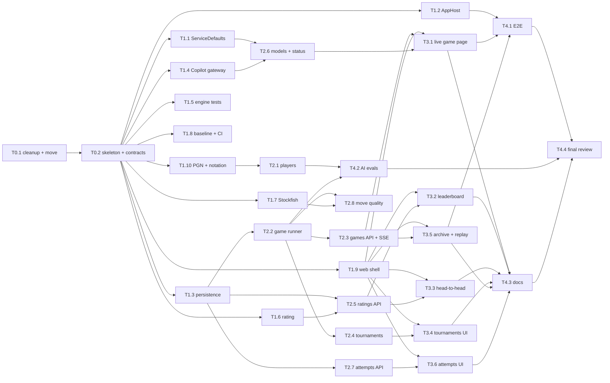

# 04 — Migration plan

How the repository gets from [01-CURRENT-STATE](01-CURRENT-STATE.md) to
[03-TARGET-ARCHITECTURE](03-TARGET-ARCHITECTURE.md). The work is split into **30 atomic
tasks** ([06-TASKS](06-TASKS.md)), each small enough for one implementation session
(Claude Haiku 5.5) and one pull request, and each owning a disjoint set of files so that tasks
in the same wave can run in parallel without merge conflicts (ADR-010).

## 1. Roles

| Role | Who | Does | Never does |
|---|---|---|---|
| **Supervisor** | the planning session (Opus) | launches task sessions, audits each merged PR against its acceptance criteria, keeps the board current, decides on contract changes, launches dependents | writes feature code |
| **Implementer** | one Haiku 5.5 session per task | implements exactly one task on its own branch, runs the task's verification, opens a PR, **merges it itself once CI is green** | edits files outside its task's *Owns* list; changes a frozen contract; merges a red PR |
| **Owner** | Konrad | accepted the plan and fully autonomous execution (2026-10-24); runs the live Copilot smoke test (needs the subscription) | — |

**Autonomy.** Everything runs without asking the owner. An implementer merges its own PR as
soon as CI is green on the head commit; the supervisor merges its own PRs the same way. Until
the CI workflow exists on `main` (T1.8), "green" means the task's *Verify* commands passed in
the session and their output is in the PR.

## 2. Waves and the dependency graph



| Wave | Tasks | Parallel sessions | Gate to the next wave |
|---|---|---|---|
| 0 | T0.1 → T0.2 | 1 (sequential) | `main` builds; `dotnet test` green; every contract from 03 §3 and §5.1 exists |
| 1 | T1.1 – T1.10 | up to 10 (recommended ≤ 6 at once) | each PR green; after the last merge, `main` green |
| 2 | T2.1 – T2.8 | up to 8, each as soon as its dependencies are merged | — |
| 3 | T3.1 – T3.6 | up to 6 | — |
| 4 | T4.1 – T4.4 | 3, then T4.4 alone | review finds no blocking item |

A task starts **as soon as all its dependencies are merged**, not when its whole wave is
ready — waves are a reading aid, the graph is the schedule. Critical path:
T0.1 → T0.2 → T1.3 → T2.2 → T2.3 → T3.1 → T4.1 → T4.4 (8 sequential merges).

## 3. Rules every implementer session follows

These are repeated verbatim in the session prompt (§4).

1. Work only on the task you were given. Branch `task/<id>-<slug>` from the latest `main`.
2. Touch **only** the paths in the task's *Owns* list. If you must change anything else —
   including a contract in 03 §3 / §5.1, `Directory.Packages.props`, `Chess.sln` or
   `Program.cs` — stop, and describe the needed change under a `## Blocked` heading in the PR.
3. Install the SDK when missing: `sudo apt-get update && sudo apt-get install -y dotnet-sdk-10.0`.
4. Before pushing run the task's *Verify* commands; every one must pass. Paste their tail
   output into the PR.
5. Tests: one per acceptance criterion at least; no test that cannot fail; no network in unit
   tests (use `FakeLlmGateway`, the InMemory provider, and fixtures).
6. No secrets, tokens or personal paths in any file. No new package unless the task names it.
7. Open the PR against `main` titled `<ID>: <title>`, with the acceptance criteria as a
   checklist, each ticked with its evidence.
8. **Merge it yourself** (squash, delete the branch) once CI is green on the head commit. Before
   T1.8 has merged there is no CI: merge once the *Verify* commands pass. If CI fails, fix and
   push again until green. If `main` moved and the PR conflicts or is behind, merge `main` into
   your branch, re-run *Verify*, push, and wait for green again.
9. Never merge with `## Blocked`. Do not edit `06-TASKS.md`; the supervisor keeps the board.

## 4. Session prompt (the supervisor sends this, filling `<ID>`)

```
You are an implementation session for konradcinkusz/llm-multi-agent-chess.
Your task is <ID> in docs/architecture/06-TASKS.md on main.

Read, in this order: CLAUDE.md (once it exists), docs/architecture/03-TARGET-ARCHITECTURE.md,
docs/architecture/04-MIGRATION-PLAN.md §3, and the <ID> section of 06-TASKS.md
(plus docs/RATING.md if the task mentions it). Follow the rules of 04 §3 exactly.
Implement only <ID>. Work fully autonomously; do not ask questions. When the Verify commands
pass, push, open the PR and merge it yourself (squash) once CI is green (04 §3 rule 8).
If you are blocked, open the PR anyway with a "## Blocked" section and do not merge.
```

## 5. Supervisor procedure

1. Launch every task whose dependencies are all merged (at most 6 sessions at once).
2. When a task's PR is merged, audit it after the fact: diff inside *Owns*; every acceptance
   criterion has code **and** a test that would fail without it (read the test bodies). A gap
   becomes a follow-up fix task, launched like any other.
3. When `main` is red, nothing new launches until a fix task has made it green.
4. Keep the board in 06-TASKS current with small supervisor PRs, merged when green.
5. A `## Blocked` PR: decide; if a contract changes, the supervisor changes it on `main` first
   (one small PR), then closes the blocked PR and re-launches the task.
6. A session that ends without a merged PR: read its transcript, then relaunch the task with
   the reason added to the prompt, or take the fix into a follow-up task.

## 6. Risks

| Risk | Mitigation |
|---|---|
| Copilot SDK API differs from what 03 §3.1 assumes | T1.4 starts with a spike against the pinned version; the gateway interface is ours, so only `Chess.Llm` changes |
| Premium-request cost of tournaments | Fake gateway everywhere except the owner's live runs; cost estimate in the tournament form; concurrency 2 |
| Engine bugs surface only under LLM play | T1.5 perft characterisation before anything depends on the engine |
| Parallel tasks drifting from the contracts | contracts compiled in wave 0; the web copies of DTOs have a test that round-trips the API's JSON (T1.9) |
| A Haiku session widens its PR | *Owns* list + supervisor rule 2 |
